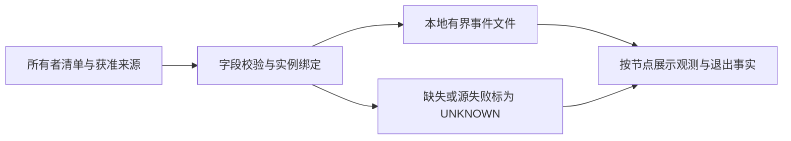

# M0-3 V0.1 基础观测与异常退出切片验收方案

2026-10-15（Asia/Shanghai），[Issue #8](https://github.com/Zwhao0/20261015/issues/8)，母 [Issue #1](https://github.com/Zwhao0/20261015/issues/1)。用户已明确授权“启动 M0-3”。选定切片：对一个所有者明确批准的真实分布式训练任务，展示有来源的身份与基础设备观测，并依据启动器的权威终止记录生成进程异常退出事件。M0 交付设计，M1 才实施；当前真实任务来源尚未落实，功能与双机验收均为 `NOT_RUN`。

## 基线与切片选择

开发分支 `codex/m0-3-slice-acceptance` 从 main `d36cdacb77b6b1b08392bf27b9b288952918aa98` 建立。[M0-2 PR #7 审核](https://github.com/Zwhao0/20261015/pull/7#issuecomment-6189223408) 对 head `7c9326b61bb539f1c2cf9435d41fb48a403772f4` 的离线矩阵给出 PASS，PR 已合并；本轮未操作合并。[18条历史证据](M0_1_INVENTORY.md)与[能力矩阵](M0_2_CAPABILITIES.md)原文保留。

[PR #9 审核评论](https://github.com/Zwhao0/20261015/pull/9#issuecomment-6189558036)对旧head `16a8bee3a1de5f40674d0dc3983862d8a9dc18ad` 要求修正来源空闲/失活与attempt/run终态两项。本次只修正文档，保留旧提交供增量复审；不表示审核已通过。

| 问题 | 选择与依据 | 风险与验证 |
| --- | --- | --- |
| 首个切片依赖哪些信号 | 任务清单、获准的进程/设备局部快照、启动器结构化终止记录；对应矩阵 C01～C03/C07、V1/V3 | 真实任务及来源 UNKNOWN；落实下表后才接入，不能从历史查询重建真实身份链 |
| 如何认定退出 | 只接受已绑定进程实例的权威终止记录；设备查询空行与采集超时只影响观测状态 | 单节点 launcher 退出不证明所有 worker 退出；回放 T02/T04/T12/T14 验证作用域 |
| 如何减少部署面 | M1 候选为 Python 标准库的本地 JSONL 规范化/回放与旁路读取，先落本地事件/摘要，无数据库、常驻服务或网页要求 | 实际解释器/运行时仍待确认；C1 来源确认前不能使用，不通过更换 CUDA/NCCL 解决差异 |
| 是否依赖 step、RAS、FR、跨机精确排序 | 均不作为切片前置依赖；无来源时显式 UNKNOWN | 基础切片不承诺 hang/fail-slow/根因；真实进度与这些增强信号留在后续范围 |

输出为每个 run attempt 的身份/基础观测/覆盖状态、可去重的进程终止事件及证据索引。基础设备字段限 GPU 身份和带单位的显存总量/已用量、利用率等实际获准字段；未读到的字段不填零。训练进度显示 UNKNOWN；有获准 step 时可保留原值和语义，不能据此扩展检测目标。



## 真实训练证据来源与接入条件

| 来源 | 所有者需明确的输入与证据 | 当前结论及接入门禁 |
| --- | --- | --- |
| 一个本项目真实训练任务 | 受控任务引用、所有者批准、启动器/版本、A/B 参与成员与预期 world size、允许读取的字段/窗口/路径；证明来源不属于禁止的旧项目 | UNKNOWN；历史 GPU PID 不证明属于本项目。没有获准任务时只完成离线方案/未来合成回放，不启动替代训练来冒充真实来源 |
| 任务身份清单 | Job ID、Run ID、attempt/restart、Host/boot/namespace、进程实例、Rank/Local Rank、可见设备与 GPU UUID 关联及采集窗口 | UNKNOWN；V1 待满足。采用 torchrun 时也要核验实际 launcher，不将 rendezvous run id 自动视作调度 Job ID |
| 权威退出记录 | 本次任务的父进程/启动器结构化 wait 结果或有明确终止语义的调度记录；对象究竟是 launcher、worker 还是整个 run；完整性与 source cursor | UNKNOWN；V3 待满足。既有任务不得 attach/reap，不能事后用裸 PID 查询恢复退出码；只有泛化错误日志时终止结论仍 UNKNOWN |
| 局部设备与进程观测 | 所有者批准的单机字段查询或结构化快照、容器与宿主 PID 映射证据 | 仅 E-A/B-01/04 历史字段可得；持久 Host ID、boot、namespace、进程启动时间及可重建 UUID 对应关系均 UNKNOWN |
| 时间及采集覆盖 | source 时区/时钟域、采集窗口、序号/轮转规则、同步误差界 | API 语义有证据；真实事件时间源/跨机误差 UNKNOWN。无误差界仍可展示按节点排列的事件 |

M1 优先读取任务所有者提供的白名单文件/事件源。仅在另行批准的新任务中，才可由 launcher 侧产生终止记录；包装方式、退出码透传及对子进程生命周期的影响需单独验收。未获准新任务时不得为取得记录新建训练、包装正在运行的任务或向其发送信号。C1 通用运行时来源、允许的部署目录、资源预算均待环境所有者确认。

## 数据契约 v0.1

规范化输入为 UTF-8 JSONL，一行一事件，`schema_version="0.1"`。以下是 M1 实现契约，不是现有接口。必填结构缺失/版本不支持的行隔离为 `INVALID_RECORD`，关联范围覆盖状态降级；合法但无法获知的字段用 JSON `null`，并在 `unknown_reasons` 按字段路径给出原因，展示为 UNKNOWN。`0`、空集合、缺失和 null 各有区别。

| 对象 | 字段与约束 |
| --- | --- |
| 公共封装 | `event_id`、`event_type`、`source_id`、`source_epoch`、`source_seq`（非负整数）、`origin`（`REAL`/`SYNTHETIC`）、`identity`、`time`、`payload`、`evidence_ref`、`unknown_reasons`；source epoch 在轮转/重建或不能延续序号时更换 |
| 任务身份 | `job_id`、`run_id`、`attempt_id`、`world_size`、`rank`、`local_rank`；rank 是 attempt 内的逻辑成员，重启不沿用旧实例；Job 与 Run 分开。成员清单列出每个预期成员及记录对象 `scope`（`worker`/`launcher`/`attempt`/`run`）；run级记录的attempt_id可为null |
| 来源合约 | `source_mode=PERIODIC/EVENT_DRIVEN/UNKNOWN`、`expected_interval_ms`、`freshness_timeout_ms`；仅已约定周期/心跳的PERIODIC源使用15秒freshness阈值，EVENT_DRIVEN及UNKNOWN源两项为null，不凭无新事件启动计时。另存`last_successful_read_monotonic_ns`和`last_record_age_ms`，读取成功与记录年龄分开 |
| 节点与进程身份 | `host_id`、`boot_id`、`pid_namespace_id`、`pid`、`process_start_ticks`（Linux 时钟 tick，附 `start_ticks_hz`）；完整实例键为 host/boot/namespace/pid/start，不以 PID 独立关联；跨 namespace 的 PID 映射须另有证据 |
| 设备身份 | `gpu_uuids`（允许多GPU或有依据的空列表）；GPU index 与 local rank 只作来源字段，不能当 UUID。`null` 表示没有映射证据；实际 UUID 仅受控保存，公开样例使用合成 token |
| 时间 | `event_time_utc`（带 Z 的 UTC 或 null）、`observed_time_utc`、`event_monotonic_ns`（整数或 null）、`observed_monotonic_ns`、`event_clock_domain_id`、`observed_clock_domain_id`（均为host/boot/clock/time namespace组合或null）、`uncertainty_ms`（非负或 null）；source 事件与接收采集时间分列，两个非空域相等才能相减 |
| 证据与未知 | `evidence_ref` 为不可变逻辑引用，配 `source_cursor`（记录位置）和 `content_sha256`（被引用记录的规范字节哈希）；引用由受控索引解析，不能当任意文件路径打开。真实原文和公开脱敏摘要分列哈希，摘要哈希不证明原始来源真实性 |

`event_type` 及其 payload：

| 类型 | payload 与语义 |
| --- | --- |
| `IDENTITY` | 成员清单/作用域与映射证据；缺环节只提供部分关联，`identity_status=UNKNOWN`；身份补证不能把历史未知事件无证据地重新归属 |
| `SNAPSHOT` | `process_presence=OBSERVED/NOT_OBSERVED/UNKNOWN`、`device_samples`（每个字段附单位/采集状态）、`progress`（step/语义/来源或 null）；NOT_OBSERVED 只表示此窗口未见 |
| `PROCESS_EXIT` | `scope=worker/launcher`、`authority`、`status_kind=EXITED/SIGNALED/UNKNOWN`、`raw_status`、`raw_status_format`、`exit_code`、`signal`、`expected_stop`（true/false/null）；只声明具体进程终止，不声明attempt或run最终结局 |
| `RUN_TERMINAL` | `scope=run`、`authority`、`proof_kind=RUN_TERMINAL/FINAL_ATTEMPT`、`outcome=COMPLETED/FAILED/CANCELLED`及证据引用；RUN_TERMINAL须来自可验证的权威run级终态。FINAL_ATTEMPT须绑定`final_attempt_id`、`no_restart_or_resume=true`的受控终态证明；字段缺失或冲突时run保持UNKNOWN |
| `SOURCE_STATUS` | `source_mode`、`status=OK/IDLE/UNKNOWN/GAP/STALE/UNAVAILABLE/INVALID_RECORD/CONFLICT`、`read_status=OK/UNAVAILABLE/UNKNOWN`、`reason`、受影响source/成员/窗口；IDLE仅表示EVENT_DRIVEN源读取成功且无预期新事件，producer是否仍在写为UNKNOWN，不证明训练健康；STALE仅用于已约定周期/心跳的源。进程实例与rank可为null，不能伪造任务实例来挂载源失败 |

退出值必须说明编码：POSIX wait status 要先确认 `WIFEXITED` 或 `WIFSIGNALED`；Python `subprocess` return code、shell status、调度器 code 不可混解。[Python 3.12 os](https://docs.python.org/3.12/library/os.html#os.waitstatus_to_exitcode)说明 Unix wait status 转换结果为退出码或负信号号。选择记录 `EXITED` 时 `exit_code` 为 0～255、`signal=null`；`SIGNALED` 时 `exit_code=null`、`signal` 为正整数；未证明编码/终止语义时均 null/UNKNOWN。shell 137 不能自行解成 SIGKILL 或 OOM。

`event_id` 对同一 `(source_id,source_epoch,source_seq)` 稳定；重读同一内容只产一个事件，相同键不同内容为 CONFLICT。跨来源重复的同实例/同终止事实合并为一个派生退出通知并附多条证据；终止事实冲突则CONFLICT/UNKNOWN，不自行选择。权威终止同时有完整进程键且可绑定本 attempt，才更新该对象状态；绑定不全可保留来源终止记录，任务归属和聚合仍 UNKNOWN。

派生摘要分三层：process以`(job_id,run_id,attempt_id,scope,process_instance)`为键，记录`EXITED_OK/EXITED_NONZERO/EXITED_SIGNAL/UNKNOWN`；attempt以`(job_id,run_id,attempt_id)`为键，仅在完整预期成员均有可信终止且无冲突时记录`ATTEMPT_EXITED_OK`（全员0）或`ATTEMPT_EXITED_WITH_FAILURE`（存在非0/信号），否则终态UNKNOWN，另保留已知失败事实；run以`(job_id,run_id)`为键，终态`COMPLETED/FAILED/CANCELLED`仅由权威run终态或受控最终attempt证明支持，否则UNKNOWN。attempt摘要没有“不会重启/续跑”的隐含含义，run键不包含attempt_id。

各层分别存`identity_status`、`coverage_status`、`lifecycle`与`evidence_refs`；process另存`last_observed_age_ms`，attempt/run另存预期/已知/已终止成员数、失败事实、`terminal_evidence_ref`及run的`final_attempt_id`。FINAL_ATTEMPT证明用于run COMPLETED时，还须该attempt完整成员全EXITED/0且无冲突；只有全员0、重试策略缺失或仍可续跑均不够。缺必需键的记录停留在来源层，不能用所有null组成共享实例。源状态事件不生成任何层的终态。

## 状态与 UNKNOWN 传播

身份状态、观测覆盖、对象生命周期是三个独立维度。`OBSERVED` 表示有一次观测，不宣称训练健康；终止后的历史事实不因采集器断开消失。以下规则按声明的process/attempt/run或来源作用域应用：

| 输入/条件 | 输出 |
| --- | --- |
| 清单/映射/时间字段缺失 | 对应字段 UNKNOWN，并列出原因；仍可展示有证据的局部字段，不猜 Rank=GPU index |
| 查询空行、PID 消失、GPU 空闲 | `process_presence=NOT_OBSERVED`，生命周期 UNKNOWN；没有退出事件 |
| 可信终止 EXITED/0 | 该进程`EXITED_OK`；完整预期成员全员0且无冲突只得出`ATTEMPT_EXITED_OK`。没有权威run级终态或受控最终attempt且不会重启/续跑的证明，run保持UNKNOWN |
| 权威run终态或受控最终attempt证明 | 核对run绑定/来源/结局/证据；直接run终态可确定其最终结局，不能补造成员终止事实。最终attempt证明须明确final_attempt_id及不会重启/续跑，宣告COMPLETED另需完整成员全员0且无冲突；证明缺失或相互冲突时run UNKNOWN |
| 可信终止 EXITED/非0 或 SIGNALED | 生成 `PROCESS_EXIT`，该对象 `EXITED_NONZERO` 或 `EXITED_SIGNAL`；`expected_stop` 从所有者终止意图证据取得，缺失为 null；根因 UNKNOWN，不判 OOM/NCCL 故障 |
| worker 的失败记录 | 可以报告该 attempt 下已有失败证据；run 最终结局仍需终态来源/重试策略，不能把一次 attempt 失败当最终任务失败；不推断其他节点退出 |
| 单节点 launcher 退出 | 仅更新该 launcher；worker 或另一节点未知，不能广播成全部 rank 退出 |
| 丢序号、截断、轮转无连续证据、权限/网络失败 | `GAP` 或 `UNAVAILABLE`；保留最后观测及 age，当前值 UNKNOWN；源恢复不自动填补历史空洞 |
| PERIODIC源超过约定15秒未见周期/心跳记录 | `STALE`，以本地单调时间计freshness；须已确认周期和15秒阈值，不能判hang/退出；源恢复只恢复新窗口，历史GAP保留 |
| EVENT_DRIVEN源长时间无新记录，读取/连续性检查正常 | `read_status=OK`、`status=IDLE`，记录年龄可为数小时；无新事件不产生STALE/GAP或退出。producer活性与训练状态仍UNKNOWN；若来源模式/读取状态未核实则status=UNKNOWN |
| 任意源读取失败/来源消失或轮转缺口 | 权限/超时/来源消失为UNAVAILABLE，确认截断/序号断层为GAP；不能以EVENT_DRIVEN的IDLE掩盖故障或覆盖历史缺口 |
| 迟到/乱序/重复 | 按 source epoch/seq 去重、记录到达顺序，迟到数据追加更正而不覆盖证据；终态后迟到旧 SNAPSHOT 不复活进程；冲突状态 UNKNOWN |
| PID复用/重启/节点重启/弹性成员变化 | 新进程实例、新 attempt 或 boot/namespace；旧终止不传播。无新清单时成员聚合 UNKNOWN |
| 跨节点墙钟差/倒退或不同单调域 | 按节点/源序号展示，禁止计算跨域持续时间或首因；标 `uncertainty_ms=null`；source seq 本身也不能证明跨源因果 |

[Python 3.12 time](https://docs.python.org/3.12/library/time.html#time.monotonic_ns)提供单调时间差语义；本契约进一步要求相同时钟域。时间回拨不阻断接收；无法解析的来源时间置 null 并保留错误原因。真实 step 无样本与 step 未变分别记录，均不触发训练停滞结论。

## 合成样例与回放验收

下列 JSON 是一份 **SYNTHETIC payload 样例包**，只演示退出编码；不是完整事件，也不是现场记录。`expected_lifecycle` 是未来回放的预期结果。M1 将按上述公共封装补全事件、清单、时钟与证据后写 fixtures；本轮只检查样例的 JSON/值一致性。

```json
{"origin":"SYNTHETIC","examples":[{"case_id":"T01","payload":{"scope":"worker","authority":"parent_wait","status_kind":"EXITED","raw_status":0,"raw_status_format":"posix_wait","exit_code":0,"signal":null,"expected_stop":false},"expected_lifecycle":"EXITED_OK"},{"case_id":"T02","payload":{"scope":"worker","authority":"parent_wait","status_kind":"EXITED","raw_status":1792,"raw_status_format":"posix_wait","exit_code":7,"signal":null,"expected_stop":false},"expected_lifecycle":"EXITED_NONZERO"},{"case_id":"T03","payload":{"scope":"worker","authority":"parent_wait","status_kind":"SIGNALED","raw_status":15,"raw_status_format":"posix_wait","exit_code":null,"signal":15,"expected_stop":null},"expected_lifecycle":"EXITED_SIGNAL"},{"case_id":"T04","payload":{"scope":"worker","authority":"log_unverified","status_kind":"UNKNOWN","raw_status":137,"raw_status_format":"shell_unverified","exit_code":null,"signal":null,"expected_stop":null},"expected_lifecycle":"UNKNOWN"}]}
```

下表是 M1 回放的测试规范。每例包含输入JSONL、初始清单、模拟接收单调时间、预期规范事件/摘要、允许未知项和 fixture 哈希；用确定性虚拟时钟，不为15秒陈旧阈值真实等待，不访问网络或 GPU。所有功能用例当前 `NOT_RUN`。

| 用例 | 输入与预期 |
| --- | --- |
| T01 正常结束 | 完整预期成员按各自实例EXITED/0：每实例一终止事件、attempt=ATTEMPT_EXITED_OK；调度器尚可能重试/阶段切换/续跑时run=UNKNOWN。仅加入权威run成功终态，或绑定最终attempt且不会重启/续跑的受控证明后，run才COMPLETED；无异常退出 |
| T02 非零退出 | 一个成员权威 EXITED/7：一条该实例异常退出，其他成员未知不补终态，根因 UNKNOWN |
| T03 信号退出 | 权威 SIGNALED/15 且意图未知：信号事实可报告，expected_stop=null，不报告 OOM |
| T04 编码不明 | shell_unverified/137：状态 UNKNOWN，不臆断 SIGKILL/OOM |
| T05 身份不完整 | 缺namespace/start/Job/Rank/GPU映射分别置null：保留局部字段，不能形成完整链或错配退出 |
| T06 PID重用与attempt重启 | 同PID不同start或attempt：旧退出不影响新实例，缺清单则新成员 UNKNOWN |
| T07 源失败与恢复 | PERIODIC已约定周期/心跳，15秒未更新才STALE；EVENT_DRIVEN连续数小时无新记录但每次读取/连续性检查成功，始终IDLE/read_status=OK，producer活性UNKNOWN，零条STALE/GAP/推测退出。模式未知为UNKNOWN；permission denied/超时/来源消失为UNAVAILABLE；恢复后的新窗口OK或IDLE，历史缺口保留 |
| T08 重复乱序冲突 | 一致记录重复/旧快照迟到/同seq异内容：分别去重/不复活/CONFLICT，绝不双发退出 |
| T09 墙钟回拨与跨域 | 本机墙钟回拨/跨机单调域不同：不算负age或跨域延迟，不宣称跨机先后；同域 age 仍准确 |
| T10 截断轮转与坏记录 | 半行JSON/未知schema/序号断层/轮转无连续证据：按帧合约待补齐、隔离坏行或GAP；EVENT_DRIVEN同样保留确认的轮转/截断缺口，不能因空闲清除；没有新字节不等于半行/截断，不能仅15秒无事件判GAP；后续合法行继续 |
| T11 无进度与指标错误 | progress=null 与step未变分开；metrics错误/哨兵值保留错误，不能填0或判健康/hang |
| T12 局部终止与意图 | 单节点launcher失败只更新该launcher；预期取消可报告退出但expected_stop=true，不判自动故障/全体退出 |
| T13 隐私与超限 | 含未知字段、原始路径/token/真实身份的候选导出拒绝；单行>16KiB/队列满给源错误，内存有界、不阻塞训练 |
| T14 成员未齐与重启 | 少一个成员、退出未证实或新boot/namespace清单未齐时attempt终态UNKNOWN；补齐全员0只得ATTEMPT_EXITED_OK。即使全员0，只要调度器仍可能重试或无最终证明，run仍UNKNOWN；新attempt不继承旧终态。独立权威run终态可确定run结局，但不能补填未知成员；最终attempt证明路径仍须完整成员终止及不会重启/续跑 |

M1 应提供标准库 `unittest` 可发现的 T01～T14 用例和离线回放入口。在 M1 对应 PR 确认实现/路径/fixture 后，从仓库根运行 `python3 -m unittest discover -s tests -v`，应 exit 0、逐例断言匹配且无跳过。当前仓库无此测试目录/回放器，命令本轮不执行，不以示例校验代替回放 PASS。

## 双机集成步骤与验收阈值

以下为待 M1 实施/单独授权的执行清单。真实任务入口与读取路径尚 UNKNOWN，因此现在不存在可诚实填写的双机启动命令。M1 集成 PR 必须用已批准对象补齐逐条命令、env白名单、scope、timeout、预计影响、退出码和受控证据索引，独立审核后执行；不得执行占位符或笼统扫描现有作业。

1. **I0 输入检查**：所有者确认任务来源/运行时、两个节点、成员规模、读取位置、退出记录权限/语义、受控保留周期与资源预算；逐源声明PERIODIC/EVENT_DRIVEN及周期/心跳合约，并明确run终态权威来源或最终attempt且不会重启/续跑的证明入口。A/B各自提供一个同窗口清单，完整身份逐成员可追溯；缺项对应验收INCONCLUSIVE，不上机补猜。以现有真实任务来源为先，没有真实异常退出样本时异常路径只做回放。
2. **I1 离线先行**：T01～T14 全通过；在本机仅对自己启动的CPU短进程验证 exit 0/7 的真实 wait 编码与退出码透传，不发送信号。信号/网络断开/坏文件等失败路径使用合成回放，不在共享训练上制造。记录待验证 commit、命令/OS/Python、exit、fixture和输出哈希。
3. **I2 受控旁路读取**：每节点1个采集进程，仅白名单来源，轮询5秒、单次读取超时1秒、并发1、每周期最多1MiB、单行16KiB、内存待处理队列最多1000行。单记录本地输入就绪至输出目标5秒；超时/超限写SOURCE_STATUS并退避到30秒，仍可读取其他已获准来源。失败不重启训练或调用GPU API。仅已约定周期/心跳的PERIODIC源以15秒判断STALE；EVENT_DRIVEN正常读取到末尾且无新事件为IDLE，不设无事件15秒GAP/STALE。末尾半行可待下周期，须按明确帧完成期限或确认截断/轮转缺口标GAP，不能因空闲推定截断；读取/权限错误、来源消失仍UNAVAILABLE，历史缺口不清除。
4. **I3 正常路径**：在所有者批准的至少10分钟真实任务窗口，比对A/B独立原始索引、规范事件与process/attempt/run摘要。自然退出时对齐进程权威终止；完整成员全员0只报告attempt退出成功。run COMPLETED须另有权威run成功终态或最终attempt且不会重启/续跑的受控证明，缺少则run完成验收INCONCLUSIVE；窗口未结束不强行等待/停止任务，可另用获准历史记录回放但标来源和时间。
5. **I4 异常路径**：优先使用同一任务自然产生的已授权历史异常终止记录，逐条回放至相同契约，并注明历史回放、不能宣称在线检测。如果没有真实异常证据，合成T02/T03只验证逻辑，真实异常路径 INCONCLUSIVE；不kill/断网/OOM/扰动NCCL制造事件。
6. **I5 资源/回退**：在同一获准任务及相近阶段先后记录关闭/开启采集各10分钟、重复3对；无可比窗口则开销 INCONCLUSIVE。结束后只停止本项目自己的采集进程，核对训练/容器仍保持原状态；保存范围内事件、失败、回退结果与 commit，交回独立审核。

| 验收项 | 提议的 V0.1 阈值与判断 |
| --- | --- |
| 身份与退出准确性 | 所有获准预期成员100%有完整链；权威终止记录100%匹配正确实例，重复退出0、推测退出0；缺链允许系统降级，但本项INCONCLUSIVE，已知错配为FAIL |
| 来源空闲与失活 | T07/T10逐源合约匹配；EVENT_DRIVEN读取健康且数小时无新事件必须IDLE，零条由空闲推测的STALE/GAP/退出；PERIODIC仅在约定周期/心跳下超15秒才STALE；模式不明为UNKNOWN，错误/来源丢失/确认轮转缺口仍UNAVAILABLE/GAP；任一混淆为FAIL |
| 分层终态准确性 | T01/T14覆盖全员0但仍可能重试/续跑：attempt可ATTEMPT_EXITED_OK，run必须UNKNOWN；无权威run终态或受控最终attempt证明却宣告COMPLETED为FAIL。缺成员/未证实退出不补attempt终态；权威run终态不补造成员事实；无真实最终证明时该项现场完成验收INCONCLUSIVE |
| 降级正确性 | T05～T14全部符合预期，任一缺失被判健康/退出/根因即FAIL；源恢复必须保留缺口 |
| 延迟 | 至少20条同源同单调域可配对记录，本地输入就绪到输出 p95≤5秒、最大≤10秒；源提供事件/采集同域时间时另报事件到输出，不能混为一项；跨机精度未知不计算跨机延迟，样本不足为INCONCLUSIVE |
| 采集资源 | 每节点采集CPU均值≤单个逻辑核1%，RSS峰值≤128MiB；不初始化CUDA/创建communicator，不开启metrics/RAS/FR。CPU按进程CPU秒/墙钟秒计算；上述是设计预算，未测量 |
| 训练影响 | 只有获准且可比的真实step时，3对窗口的每对吞吐降幅均≤2%；记录原始值、阶段差异与波动。没有step来源或噪声无法区分2%时INCONCLUSIVE，不能由GPU利用率反推开销PASS |
| 有界存储 | 每节点本项目输出硬上限100MiB；写满则停止写入并在stderr报告一次源失败，不删除旧记录、不阻塞训练；输出目录0700、文件0600；不截断原始输入 |
| 回退 | 停本项目采集后≤30秒退出，不发送信号给训练/launcher/容器；未触及驱动/环境/训练源码。若不满足则FAIL并保存症状，不扩大到容器清理 |

上述数值是本次设计选择，供 M0-3 审核确认，不是现场测量结果。真实异常证据缺失不阻断离线设计审核；M0-Gate可审核设计与风险，但不能把I3/I4未验证写成运行验收PASS。M1集成验收也不得以合成或历史回放冒充实时双机PASS。

## 证据保留与回退

真实Host/IP/PID/GPU UUID、调度标识、路径与原始日志仅保留在获准受控索引。公开只导出逻辑A/B、合成token、聚合计数、退出语义、UNKNOWN原因和白名单脱敏摘要/哈希；不导出任意payload/环境/命令行/原始RAS JSON。脱敏映射跨同一run保持一致并有受控版本，跨run默认隔离。原始与公开摘要各自哈希，人工复核后发布，拒绝未知字段。

执行前由所有者填写保存位置、可读人员、保留期限与到期处理；未确认则不持久化真实样本。没有自动删除任务；到期处理另获授权。RAS/FR不在本切片范围；未来若授权V5/V6，必须另外明确敏感字段白名单、访问控制、采样和保留规则，不能上传完整JSON。

本轮只有文档，无服务器部署。文档撤销走审查后的revert或后续修正，不覆盖失败历史。M1旁路回退先停自己的采集入口、记录缺口并保留输出；不修改时钟、驱动/CUDA/NCCL、训练源码/退出处理，不删除/停止/重启/新建容器，不删除镜像/卷。若未来需要修改训练入口，应另立可回退PR与授权，不能借本方案默认执行。

## M1 候选 Issue 与门禁

这里只列候选，不创建/启动M1任务。依赖顺序为C1→C2→C3→C4；M0-Gate需ChatGPT独立审核及用户最终批准，具体服务器访问/任务接入仍需相应授权。

| 候选 | DoD与证据 |
| --- | --- |
| C1 契约与确定性离线回放 | 固定schema/字段/枚举/错误语义，T01～T14 fixtures与期望输出、unittest命令、逐例结果/哈希；零网络/GPU依赖 |
| C2 所有者任务来源与身份适配 | V1/V3输入明确，白名单/实例键/成员清单可核对，缺映射可降级；提供一个真实任务的受控证据和脱敏摘要；来源未落实则报告阻塞，不实现猜测适配器 |
| C3 本地旁路读取与终止事件 | 实现去重/源状态/本地有界输出，消费权威终止记录；CPU自有子进程exit 0/7验透传和回退，不控制现有训练；代码与回放CI通过 |
| C4 双机集成与开销验收 | 以批准的实际命令执行I0～I5，报告每项PASS/FAIL/NOT_RUN/INCONCLUSIVE、准确性/资源/覆盖/回退；真实异常与实时路径分别给证据，不含故障注入 |

M0-Gate 材料：M0-1与M0-2限定审核已在GitHub；本方案/本PR精确head/tree、验证与M1候选齐备后交ChatGPT审核。待审核/待批准项仍为 INCONCLUSIVE。任务来源、运行时来源、退出样本、成员清单、允许的存储与命令是M1现场执行阻塞，不能从设计批准推断已满足。

## 本轮验证与恢复入口

本轮验证只覆盖文档规范、变更范围、合成payload数值和历史材料一致性，命令/环境/退出码见[STATUS](STATUS.md)。T01～T14功能回放、CPU进程测试、I0～I5现场及开销均 `NOT_RUN`。精确交付head/tree、当前PR CI run/job/log和Draft状态保存于本任务PR；恢复顺序见[HANDOFF](HANDOFF.md)。

除已有矩阵来源外，本方案参考Python 3.12官方os/time API和[PyTorch v2.13.0 torchrun源码](https://github.com/pytorch/pytorch/blob/v2.13.0/torch/distributed/run.py)中的Run/Rank/重启字段语义；后者[许可证](https://github.com/pytorch/pytorch/blob/v2.13.0/LICENSE)。只引用接口，不复制外部实现，不证明当前任务采用这些接口；官方3.12文档补丁更新不代替现场3.12.3实测。
